# Final Project: 4-bit Arithmetic Unit

**ENCE 3501 VLSI | University of Denver | Fall Quarter 2026 | Charlie Shields**

4-bit add/subtract unit with tri-state outputs, built from the Lab 5 standard cells (`NOT`, `NAND`, `XOR`, `FA`) plus one new cell (`TRI`). Schematic and layout are in Electric VLSI (`mocmos`, λ = 0.3 µm) and simulated in LTspice with the C5 models. The layout is a single row of four bit slices.

| `Sub` | Operation |
|---|---|
| 0 | S = A + B |
| 1 | S = B + ~A + 1 (= B − A) |

---

## Architecture

Each bit slice is `XOR` → `FA` → `TRI`:

- `XOR(Aᵢ, Sub)` passes Aᵢ through when `Sub` = 0 and inverts it when `Sub` = 1, giving ~A.
- `Sub` also drives the carry-in of bit 0, which supplies the "+1".
- The four full adders form a ripple-carry chain. `Cout` is the carry out of bit 3.
- Each sum bit goes through a tri-state buffer to output Sᵢ. With `En` = 1 the sum drives the pin. With `En` = 0, the outputs are Hi-Z, so the ALU can share a bus.

| Pin | Dir | |
|---|---|---|
| `A0`–`A3`, `B0`–`B3` | in | operands, bit 0 = LSB |
| `Sub` | in | 0 = add, 1 = subtract |
| `En` | in | output enable |
| `S0`–`S3` | out | result S (tri-state) |
| `Cout` | out | carry out (B ≥ A when subtracting) |
| `vdd`, `gnd` | | 5 V rails |

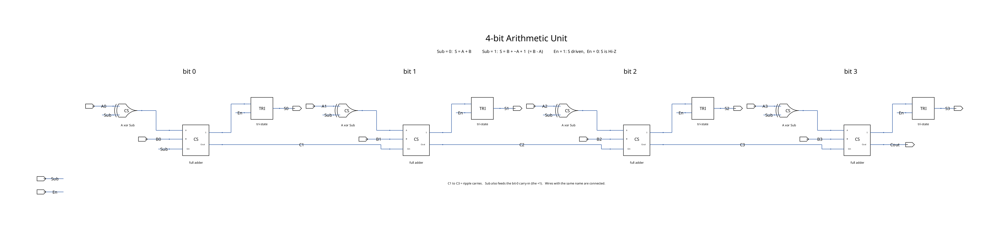

*`ALU4{sch}`: four `XOR` / `FA` / `TRI` slices, wired directly. Carries between bits are labelled `C1`–`C3`; `Sub` and `En` run along the bottom.*

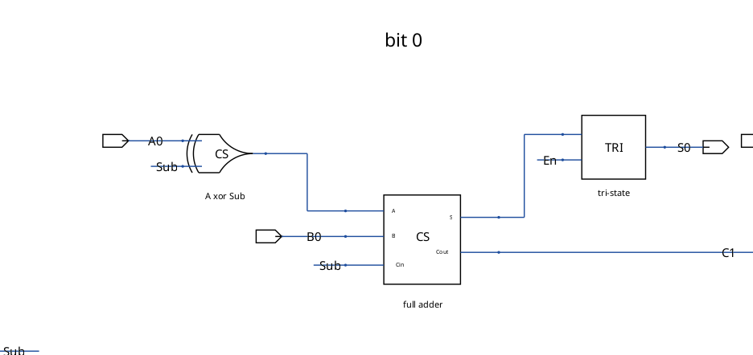

*Bit 0 close-up: `A0` and `Sub` into the XOR, the result into the full adder's `A` input, the sum into the tri-state buffer, out to `S0`.*

---

## Cells

| Cell | Transistors | Source |
|---|---|---|
| `NOT` | 2 | Lab 5 |
| `NAND` | 4 | Lab 5 |
| `XOR` | 12 | Lab 5 |
| `FA` | 36 (2 `XOR` + 3 `NAND`) | Lab 5. Only change: layout export `S` renamed to `Sum` to match the schematic |
| `TRI` | 8 | new |
| `ALU4` | 224 (4 × (12 + 36 + 8)) | new |

All transistors are 6λ/2λ (W = 1.8 µm, L = 0.6 µm), the same as Lab 5.

### Cell screenshots (Electric)

| Cell | Schematic | Layout |
|---|---|---|
| `NOT` | 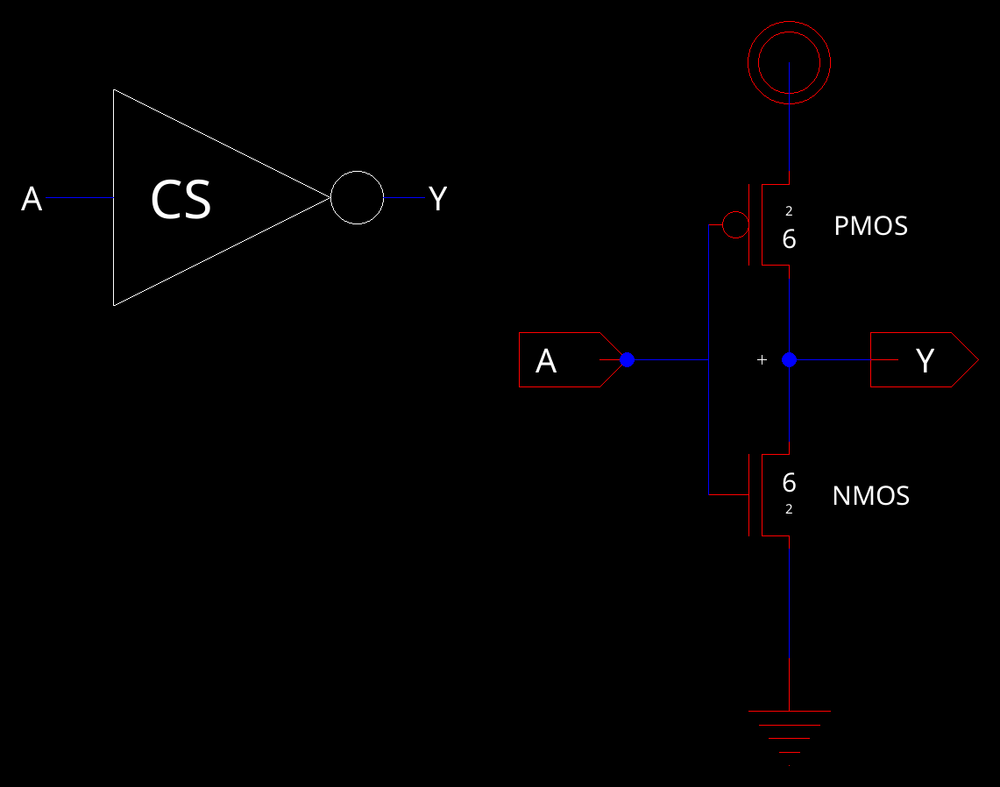 | 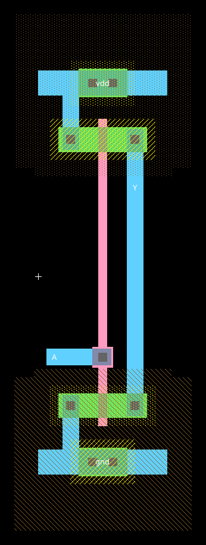 |
| `NAND` | 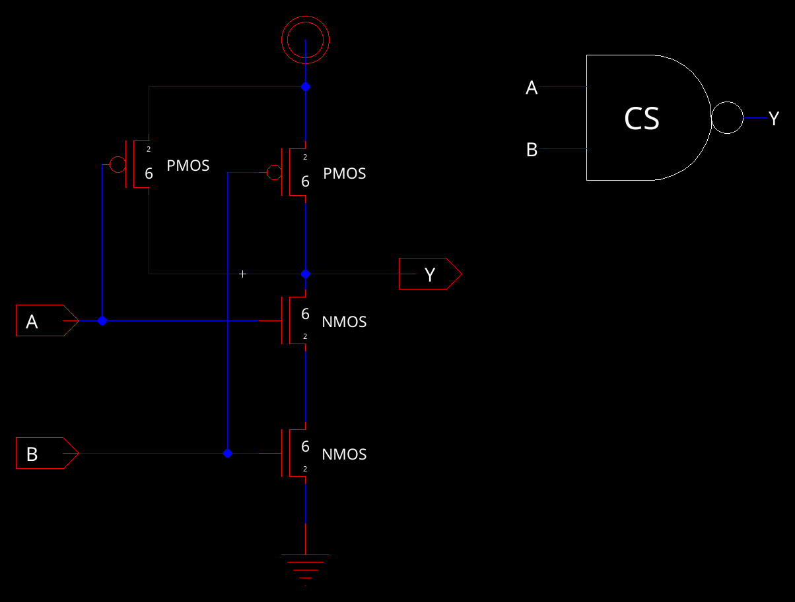 | 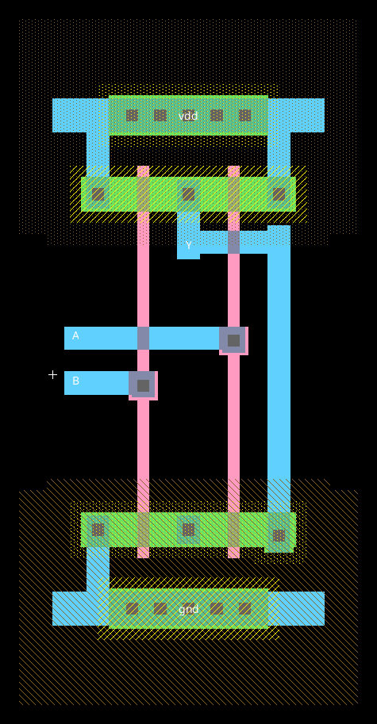 |
| `XOR` | 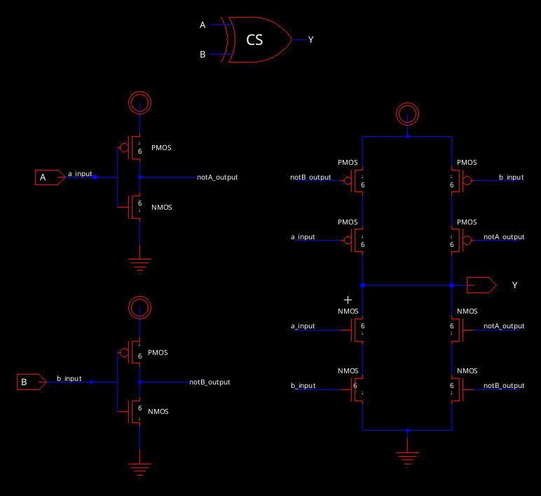 | 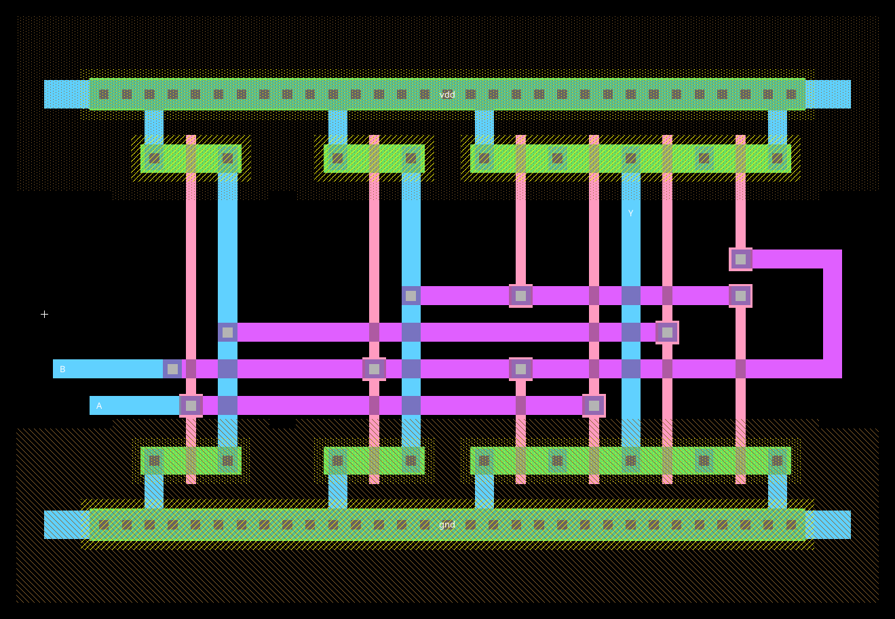 |
| `FA` | 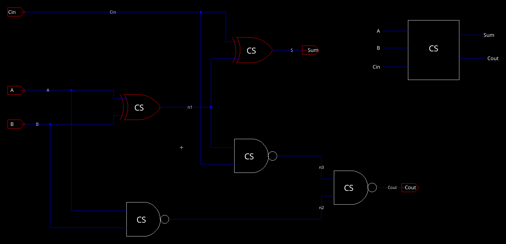 | 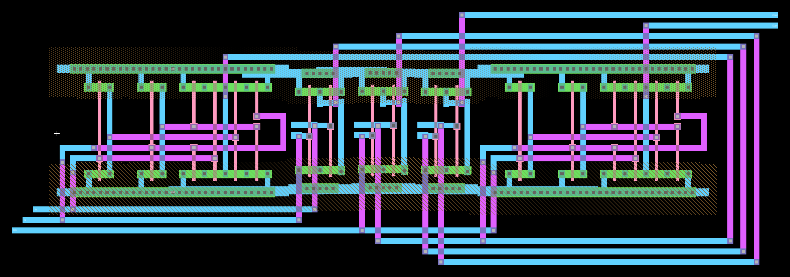 |

### Tri-state buffer (`TRI`)

Two inverters make `D_bar` = ~D and `En_bar` = ~En. These drive a clocked-CMOS style stack:

```
vdd ─ P(En_bar) ─ P(D_bar) ─ Y ─ N(D_bar) ─ N(En) ─ gnd
```

When `En` = 1, both outer devices are on and the stack is an inverter of `D_bar`, so Y = D. When `En` = 0, both outer devices are off and Y floats.

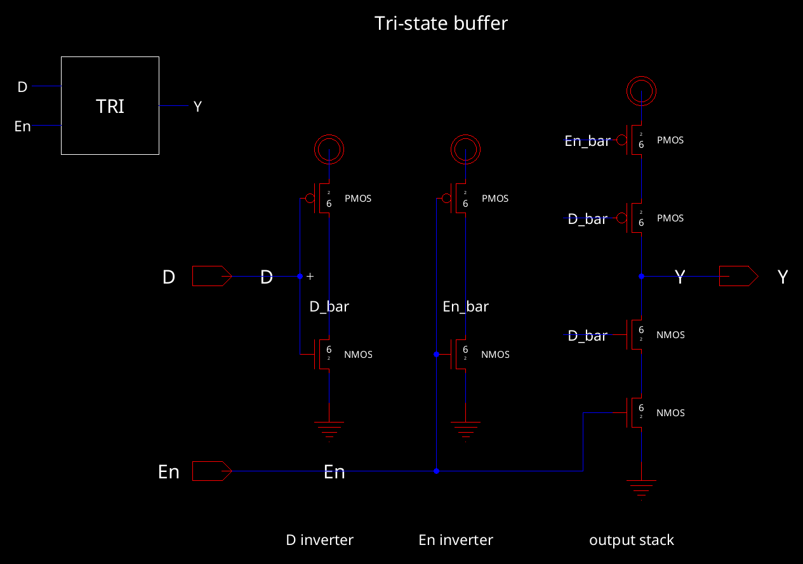

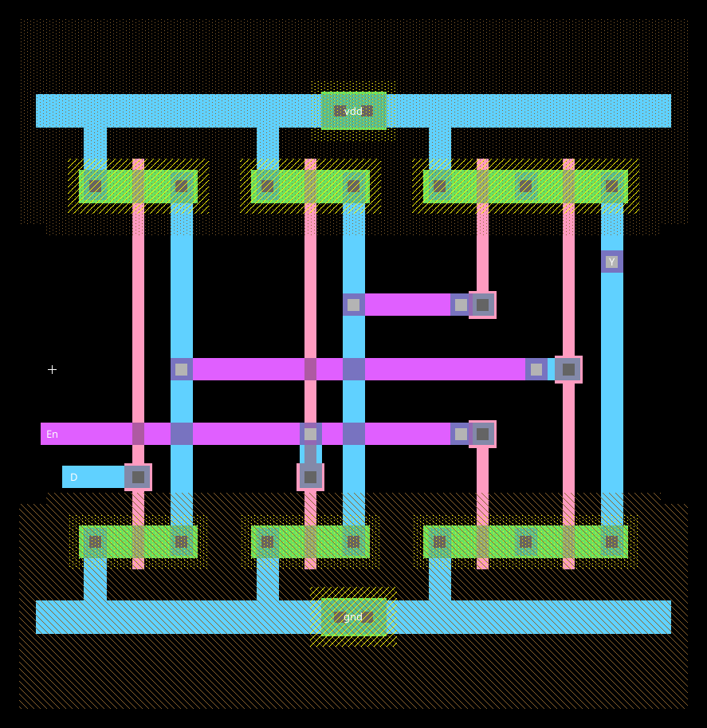

*`TRI{lay}`: the D inverter, the En inverter, then the 4-transistor stack sharing one diffusion strip on each side. Rails are at the same height as `NOT`/`XOR`. `D_bar`, `En_bar` and `En` cross the cell in metal-2.*

---

## Layout

Everything sits in one row. Each bit slice reads left to right:

`Sub` / `Aᵢ` taps → `XOR` → gap with the XOR-output, `Bᵢ` and carry verticals → `FA` → gap with the sum and `En` verticals → `TRI`

Instances are named `XOR_bitN`, `FA_bitN`, `TRI_bitN`.

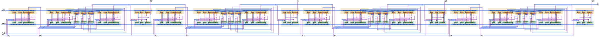

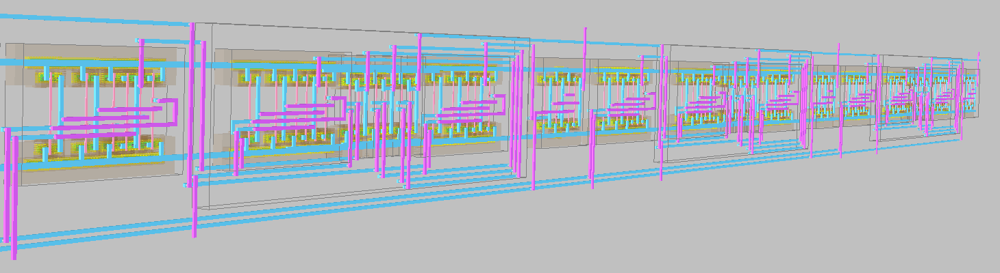

*`ALU4{lay}` in Electric's 3D view.*

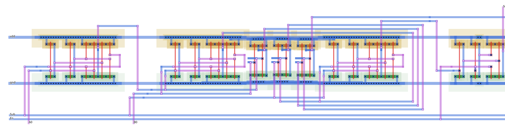

*Bit 0 slice. The `XOR` output leaves upward and crosses to the full adder's `A` input in the gap. `Cout` of each `FA` runs right along the top at y = 90 to the next slice's `Cin`. `Sub` and `En` are metal-1 buses under the row.*

Routing rules:

- **Metal-1 horizontal, metal-2 vertical.** Every vertical that crosses a rail is metal-2, so nothing shorts to vdd/gnd.
- **Rails.** All cells sit with vdd at y = 49 and gnd at y = −45. Every cell's `vdd`/`gnd` port is chained with 6λ metal-1 straps, and both rails are exported at the left end.
- **Pins.** `Aᵢ`, `Bᵢ` are metal-2 pins on the bottom edge. `Sᵢ` are metal-2 pins on the top edge. `Sub`, `En`, `vdd`, `gnd` are on the left end and `Cout` is on the right end.

| | |
|---|---|
| Size | 4007λ × 240λ = **1202 µm × 72 µm** |
| Slice pitch | 990λ |

---

## Verification

| Check | Result |
|---|---|
| LVS (Electric NCC, hierarchical, sizes checked) | **match** for `NOT`, `NAND`, `XOR`, `FA`, `TRI`, `ALU4` |
| DRC `TRI` | 0 errors |
| DRC `ALU4` | no width or spacing violations between different nets. 113 same-net "notch" flags where the rail strap overlaps the `NAND` rails inside `FA` (which sit a few λ lower than the `XOR` rails), the same as `FA` on its own |
| Switch-level check of the extracted layout netlist | 512/512 input combinations correct, outputs Z when `En` = 0 |
| LTspice, exhaustive (below) | 512/512 correct |
| LTspice on the extracted **layout** netlist (with diffusion parasitics) | 512/512 correct, demo vectors identical |

---

## Simulation

The decks were written by Electric from the `ALU4_sim` and `ALU4_sim_all` cells, which hold the `ALU4` icon and a SPICE code block.

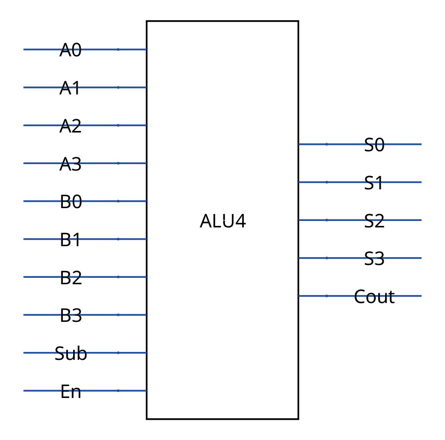

### Test vectors (`ALU4_sim`)

```
vdd vdd 0 DC 5
va0..va3, vb0..vb3, vsub, ven: PWL, one vector every 40 ns
vmid mid 0 DC 2.5
rl0..rl3, rlc: 100k from S0..S3 and Cout to 2.5 V   (shows Hi-Z as 2.5 V)
.tran 0 400n 0 50p
.include C5_models.txt
```

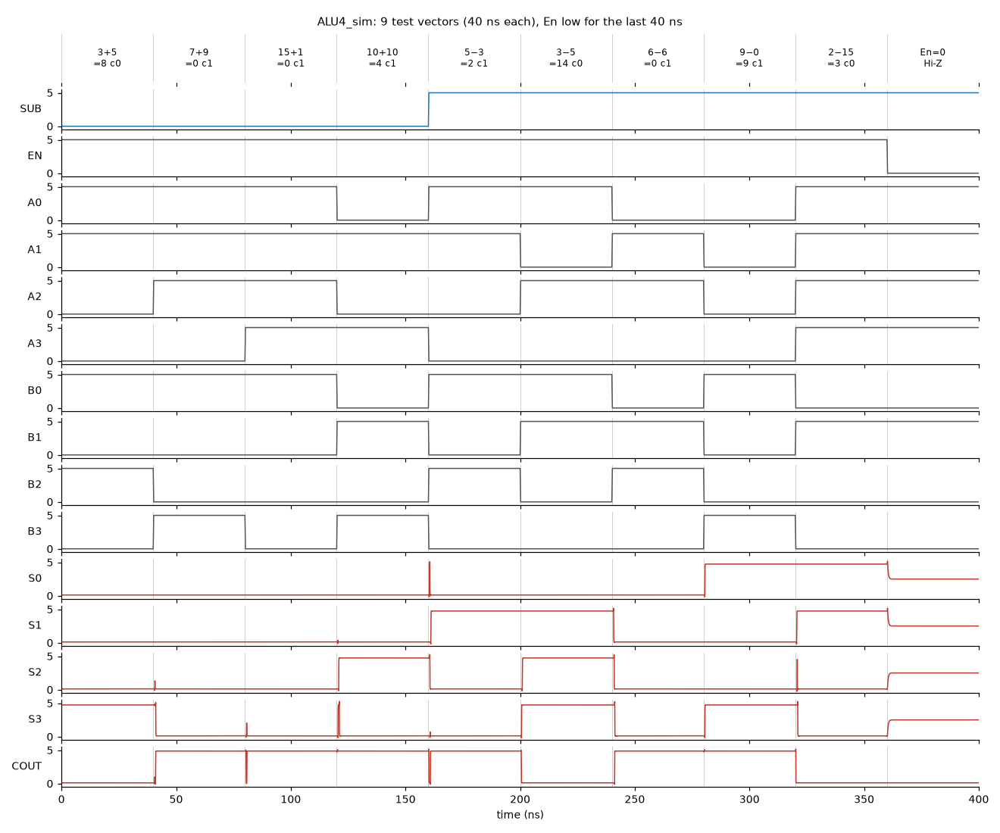

| t (ns) | Sub | A | B | S3..S0 | Cout | S low / high |
|---|---|---|---|---|---|---|
| 38 | 0 | 3 (0011) | 5 (0101) | 1000 = 8 | 0 | 0.12 / 4.74 V |
| 78 | 0 | 7 (0111) | 9 (1001) | 0000 = 0 | 1 | 0.12 V |
| 118 | 0 | 15 (1111) | 1 (0001) | 0000 = 0 | 1 | 0.12 V |
| 158 | 0 | 10 (1010) | 10 (1010) | 0100 = 4 | 1 | 0.12 / 4.74 V |
| 198 | 1 | 3 (0011) | 5 (0101) | 0010 = 2 | 1 | 0.12 / 4.74 V |
| 238 | 1 | 5 (0101) | 3 (0011) | 1110 = 14 (−2) | 0 | 0.12 / 4.74 V |
| 278 | 1 | 6 (0110) | 6 (0110) | 0000 = 0 | 1 | 0.12 V |
| 318 | 1 | 0 (0000) | 9 (1001) | 1001 = 9 | 1 | 0.12 / 4.74 V |
| 358 | 1 | 15 (1111) | 2 (0010) | 0011 = 3 (−13) | 0 | 0.12 / 4.74 V |
| 398 | `En` = 0 | 15 | 2 | Hi-Z | 0 | 2.50 V |

- **All 9 results are correct.** For subtraction, `Cout` = 1 means B ≥ A (no borrow).
- **The levels sit 0.12 V inside the rails only because of the 100 kΩ test load to 2.5 V.** The exhaustive run has no load and gives full 0 V / 5 V.
- **With `En` low, all four outputs float to the 2.5 V load bias** while `Cout`, which is not tri-stated, keeps driving.
- **The short spikes at vector boundaries are glitches.** As in Lab 5, the inputs and the ripple carry don't all change at the same instant. Every output settles well inside each vector.

### Exhaustive test (`ALU4_sim_all`)

The vector counts B (bits 0–3), A (bits 4–7) and `Sub` (bit 8) in binary, one step every 20 ns, so all 512 combinations run in 10.24 µs:

```
vb0 b0 0 PULSE(0 5 19.9n 0.2n 0.2n 19.8n 40n)    ... period doubles each bit ...
vsub sub 0 PULSE(0 5 5119.9n 0.2n 0.2n 5119.8n 10240n)
ven en 0 DC 5
.tran 0 10240n 0 100p
```

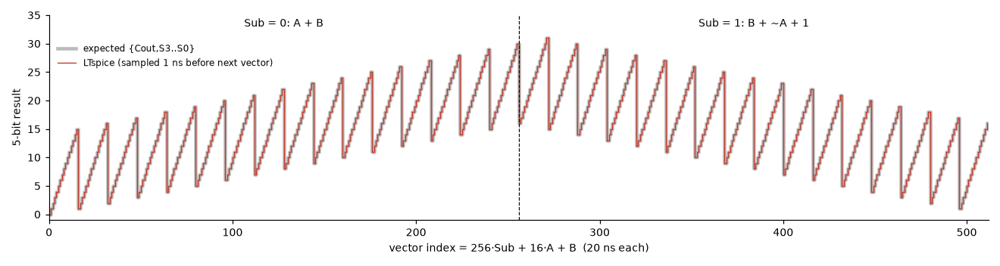

`scripts/check_all.py` samples `{Cout, S3..S0}` 1 ns before each step and compares it with A + B or B + ~A + 1:

```
512/512 vectors correct
```

The slowest transition is when a carry ripples through all four bits, for example 13 − 5 coming from 12 − 5 (0111 → 1000). The last output crosses 2.5 V **1.6 ns** after the input edge, with no load. The median over all vectors is 0.75 ns.

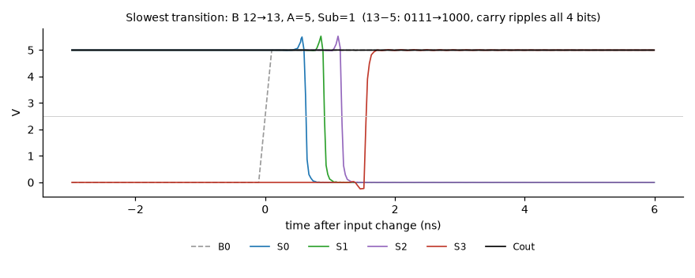

---

### Layout simulation (`ALU4_lay_sim*`)

Same two test benches, but run on the netlist Electric extracts from `ALU4{lay}` instead of the schematic. That netlist includes the source/drain area and perimeter of every transistor (AS/AD/PS/PD), so it adds the diffusion capacitance the schematic leaves out.

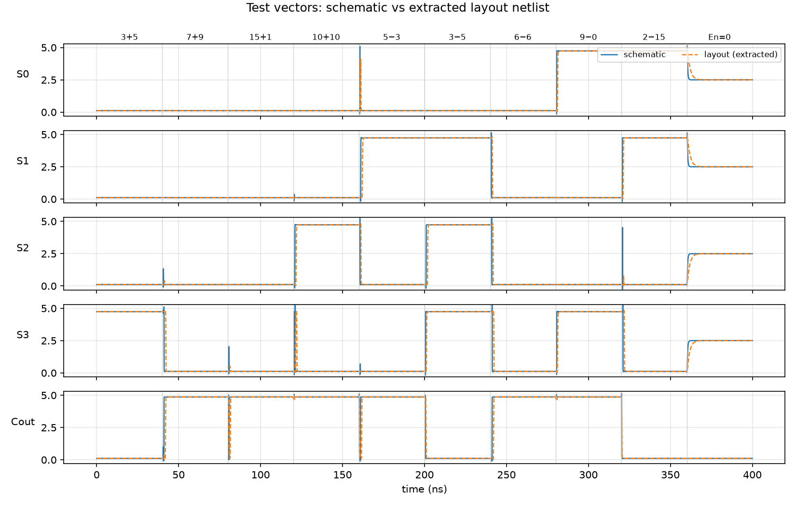

| | Schematic | Layout |
|---|---|---|
| Exhaustive | 512/512 | 512/512 |
| Demo vectors (levels at sample points) | all correct | identical |
| Slowest settle | 1.6 ns | 3.0 ns |
| Median settle | 0.75 ns | 1.6 ns |

The layout is about 2× slower because of the extra diffusion capacitance. That is still far inside the 20 ns per vector. `scripts/settle.py` measures the settle times.

## Notes

- **The SPICE decks were exported with Electric in batch mode**, which ignores the library's λ = 300 nm setting and writes L = 0.4U / W = 1.2U. Every device is 2λ/6λ, so the decks were rescaled to L = 0.6U / W = 1.8U, which is what the GUI writes (same as Lab 5). Re-exporting from the GUI (Tools → Simulation (Spice) → Write Spice Deck on `ALU4_sim`) gives the same netlist.
- **The layout decks were rescaled the same way:** L, W, PS and PD × 1.5 and AS, AD × 2.25. Their model names were changed from `N`/`P` to `NMOS`/`PMOS` to match `C5_models.txt`, and `gnd` is tied to node 0.
- **The exhaustive `.raw` files aren't included** (about 20 MB each). Re-run `ltspice -b sim/ALU4_sim_all.spi` (or `ALU4_lay_sim_all.spi`) (about 20 s), then `python3 scripts/check_all.py sim/ALU4_sim_all.raw`.
- **`scripts/gen_alu_cs.py` generated `ALU_cs.jelib` from `lab5/Lab5.jelib`.** It copies the Lab 5 cells and adds `TRI`, `ALU4` and the sim cells.

## Files

| Path | Purpose |
|---|---|
| `ALU_cs.jelib` | Electric library: Lab 5 cells, `TRI`, `ALU4` (sch/lay/icon), `ALU4_sim`, `ALU4_sim_all` |
| `sim/ALU4_sim.spi`, `.raw`, `.log` | Test-vector deck and results |
| `sim/ALU4_sim_all.spi`, `.log` | Exhaustive deck |
| `sim/C5_models.txt` | C5 SPICE models |
| `sim/ALU4_lay_sim.spi`, `ALU4_lay_sim_all.spi` | Same decks run on the extracted layout netlist |
| `scripts/` | Library generator, LTspice `.raw` reader, exhaustive checker, settle-time measurement |
| `images/` | Figures |
