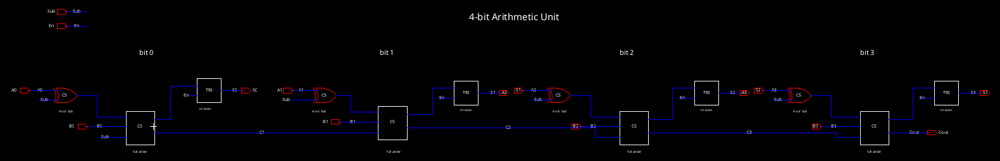
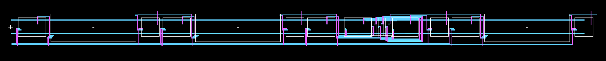
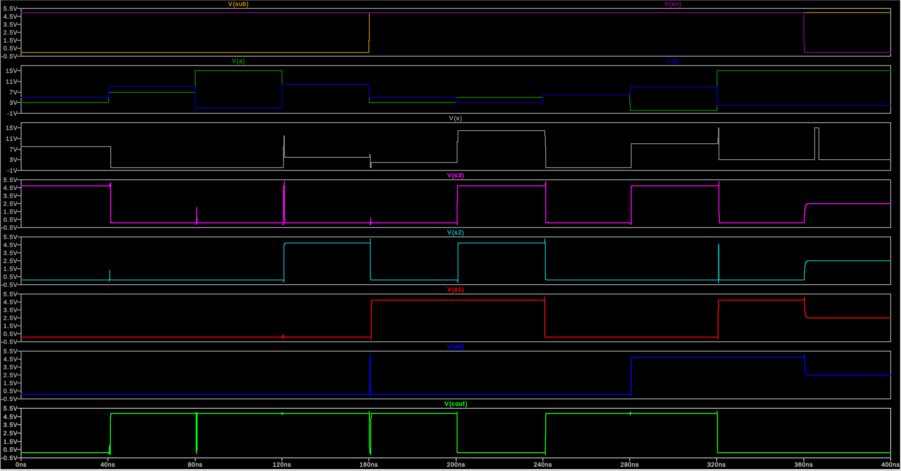
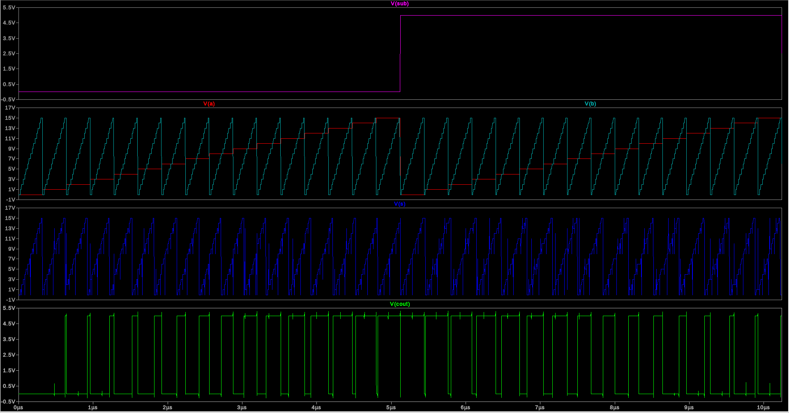
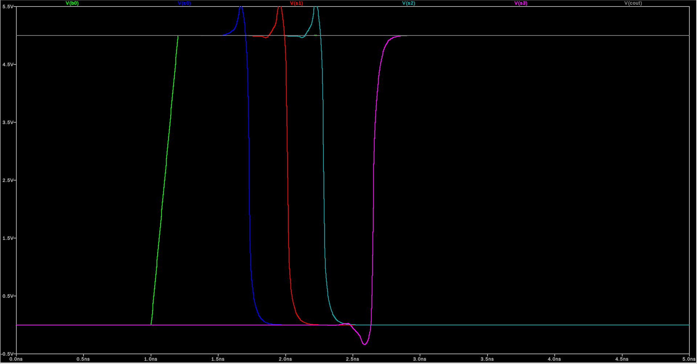
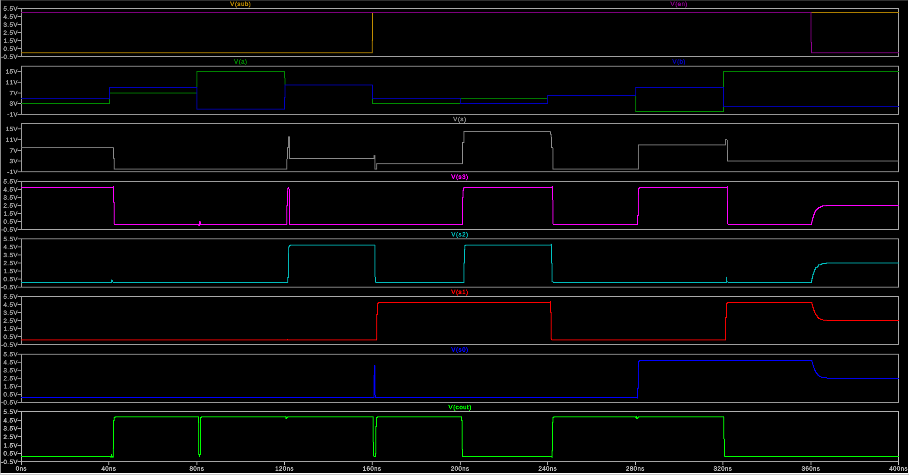
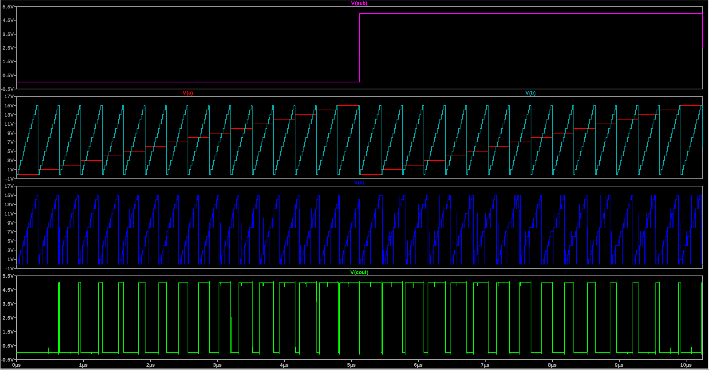
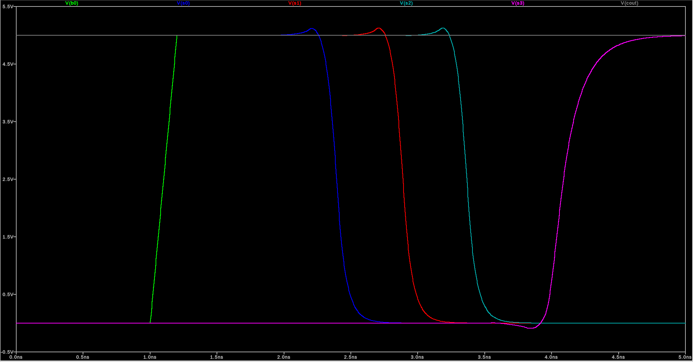

# Final Project: 4-bit Arithmetic Unit

**ENCE 3501 VLSI | University of Denver | Fall Quarter 2026 | Charlie Shields**

4-bit add/subtract unit with tri-state outputs, built from the Lab 5 standard cells (`NOT`, `NAND`, `XOR`, `FA`) plus one new cell (`TRI`). Schematic and layout are in Electric VLSI (`mocmos`, λ = 0.3 µm) and simulated in LTspice with the C5 models. 

| `Sub` | Operation |
|---|---|
| 0 | S = A + B |
| 1 | S = B + ~A + 1 (= B − A) |

---

## Architecture

Each bit slice is `XOR` → `FA` → `TRI`:

- The four full adders form a ripple-carry chain. `Cout` is the carry out of bit 3.
- Each sum bit goes through a tri-state buffer to output Sᵢ so the ALU can share a bus.

| Pin | Dir | |
|---|---|---|
| `A0`–`A3`, `B0`–`B3` | in | operands, bit 0 = LSB |
| `Sub` | in | 0 = add, 1 = subtract |
| `En` | in | output enable |
| `S0`–`S3` | out | result S (tri-state) |
| `Cout` | out | carry out (B ≥ A when subtracting) |
| `vdd`, `gnd` | | 5 V rails |



*`ALU4{sch}` in Electric: four `XOR` / `FA` / `TRI` slices, wired directly. Carries between bits are labelled `C1`–`C3`.*

---

## Cells

| Cell | Transistors | Source |
|---|---|---|
| `NOT` | 2 | Lab 5 |
| `NAND` | 4 | Lab 5 |
| `XOR` | 12 | Lab 5 |
| `FA` | 36 (2 `XOR` + 3 `NAND`) | Lab 5. Only change: layout export `S` renamed to `Sum` to match the schematic |
| `TRI` | 8 | new |
| `ALU4` | 224 (4 × (12 + 36 + 8)) | new |

All transistors are 6λ/2λ (W = 1.8 µm, L = 0.6 µm), the same as Lab 5.

### Cell screenshots (Electric)

| Cell | Schematic | Layout |
|---|---|---|
| `NOT` |  |  |
| `NAND` |  |  |
| `XOR` |  |  |
| `FA` |  |  |

### Tri-state buffer (`TRI`)

Two inverters make `D_bar` = ~D and `En_bar` = ~En. These drive a clocked-CMOS style stack:

```
vdd ─ P(En_bar) ─ P(D_bar) ─ Y ─ N(D_bar) ─ N(En) ─ gnd
```

When `En` = 1, both outer devices are on and the stack is an inverter of `D_bar`, so Y = D. When `En` = 0, both outer devices are off and Y floats.


*`TRI{lay}`: the D inverter, the En inverter, then the 4-transistor stack sharing one diffusion strip on each side. Rails are at the same height as `NOT`/`XOR`. `D_bar`, `En_bar` and `En` cross the cell in metal-2.*

---

## Layout

`Sub` / `Aᵢ` → `XOR` → `Bᵢ` → `FA` → `En` → `TRI`

Instances are named `XOR_bitN`, `FA_bitN`, `TRI_bitN`.




*The top level in Electric.*


*`ALU4{lay}` in Electric's 3D view.*


*Bit 0 slice.*

| | |
|---|---|
| Size | 4007λ × 240λ = **1202 µm × 72 µm** |
| Slice pitch | 990λ |

---

## Verification

| Check | Result |
|---|---|
| LVS (Electric NCC, hierarchical, sizes checked) | **match** for `NOT`, `NAND`, `XOR`, `FA`, `TRI`, `ALU4` |
| DRC `TRI` | 0 errors |
| DRC `ALU4` | 0 errors |
| LTspice, on schematic |
| LTspice on the **layout** |

---

## Simulation


### Test sim (`ALU4_sim`)

```
vdd vdd 0 DC 5
va0..va3, vb0..vb3, vsub, ven: PWL, one vector every 40 ns
vmid mid 0 DC 2.5
rl0..rl3, rlc: 100k from S0..S3 and Cout to 2.5 V   (shows Hi-Z as 2.5 V)
.tran 0 400n 0 50p
.include C5_models.txt
```



| t (ns) | Sub | A | B | S3..S0 | Cout | S low / high |
|---|---|---|---|---|---|---|
| 38 | 0 | 3 (0011) | 5 (0101) | 1000 = 8 | 0 | 0.12 / 4.74 V |
| 78 | 0 | 7 (0111) | 9 (1001) | 0000 = 0 | 1 | 0.12 V |
| 118 | 0 | 15 (1111) | 1 (0001) | 0000 = 0 | 1 | 0.12 V |
| 158 | 0 | 10 (1010) | 10 (1010) | 0100 = 4 | 1 | 0.12 / 4.74 V |
| 198 | 1 | 3 (0011) | 5 (0101) | 0010 = 2 | 1 | 0.12 / 4.74 V |
| 238 | 1 | 5 (0101) | 3 (0011) | 1110 = 14 (−2) | 0 | 0.12 / 4.74 V |
| 278 | 1 | 6 (0110) | 6 (0110) | 0000 = 0 | 1 | 0.12 V |
| 318 | 1 | 0 (0000) | 9 (1001) | 1001 = 9 | 1 | 0.12 / 4.74 V |
| 358 | 1 | 15 (1111) | 2 (0010) | 0011 = 3 (−13) | 0 | 0.12 / 4.74 V |
| 398 | `En` = 0 | 15 | 2 | Hi-Z | 0 | 2.50 V |

- **All 9 results are correct.** For subtraction, `Cout` = 1 means B ≥ A (no borrow).
- **With `En` low, all four outputs float to the 2.5 V load bias** while `Cout`, which is not tri-stated, keeps driving.

### Full sim test (`ALU4_sim_all`)

The vector counts B (bits 0–3), A (bits 4–7) and `Sub` (bit 8) in binary, one step every 20 ns, so all 512 combinations run in 10.24 µs:

```
vb0 b0 0 PULSE(0 5 19.9n 0.2n 0.2n 19.8n 40n)    ... period doubles each bit ...
vsub sub 0 PULSE(0 5 5119.9n 0.2n 0.2n 5119.8n 10240n)
ven en 0 DC 5
.tran 0 10240n 0 100p
```



`scripts/check_all.py` samples `{Cout, S3..S0}` 1 ns before each step and compares it with A + B or B + ~A + 1:

```
512/512 vectors correct
```

The slowest transition is when a carry ripples through all four bits, for example 13 − 5 coming from 12 − 5 (0111 → 1000). The last output crosses 2.5 V **1.6 ns** after the input edge, with no load. The median over all vectors is 0.75 ns.

`ALU4_worst.spi` runs just that transition (Sub = 1, A = 5, B steps 12 → 13 at 1 ns) so it can be plotted on its own:



---

### Layout simulation (`ALU4_lay_sim*`)

Same two test benches, but run on the netlist Electric extracts from `ALU4{lay}` instead of the schematic. That netlist includes the source/drain area and perimeter of every transistor (AS/AD/PS/PD), so it adds the diffusion capacitance the schematic leaves out.



*`ALU4_lay_sim`: the test on the extracted layout. Same as the schematic.*



*`ALU4_lay_sim_all`: all 512 combinations on the extracted layout.*



*`ALU4_lay_worst`: the same slowest transition on the layout. `S3` settles about 3 ns after the edge instead of 1.6 ns.*

| | Schematic | Layout |
|---|---|---|
| Exhaustive | 512/512 | 512/512 |
| Demo vectors (levels at sample points) | all correct | identical |
| Slowest settle | 1.6 ns | 3.0 ns |
| Median settle | 0.75 ns | 1.6 ns |

The layout is about 2× slower than the schematic.

## Files

| Path | Purpose |
|---|---|
| `ALU_cs.jelib` | Electric library: Lab 5 cells, `TRI`, `ALU4` (sch/lay/icon), `ALU4_sim`, `ALU4_sim_all` |
| `sim/ALU4_sim.spi`, `.raw`, `.log` | Test-vector deck and results |
| `sim/ALU4_sim_all.spi`, `.log` | Exhaustive deck |
| `sim/C5_models.txt` | C5 SPICE models |
| `sim/ALU4_lay_sim.spi`, `ALU4_lay_sim_all.spi` | Same decks run on the extracted layout netlist |
| `sim/ALU4_worst.spi`, `ALU4_lay_worst.spi` | Slowest transition only, schematic and layout |
| `sim/*.plt` | LTspice plot settings for each deck |
| `scripts/` | Library generator, LTspice `.raw` reader, exhaustive checker, settle-time measurement, `.plt` generator |
| `images/` | Figures |
| `viewer/index.html` | Interactive design explorer: click through the hierarchy, schematic and layout side by side, cross-probed by NCC (open in a browser) |
