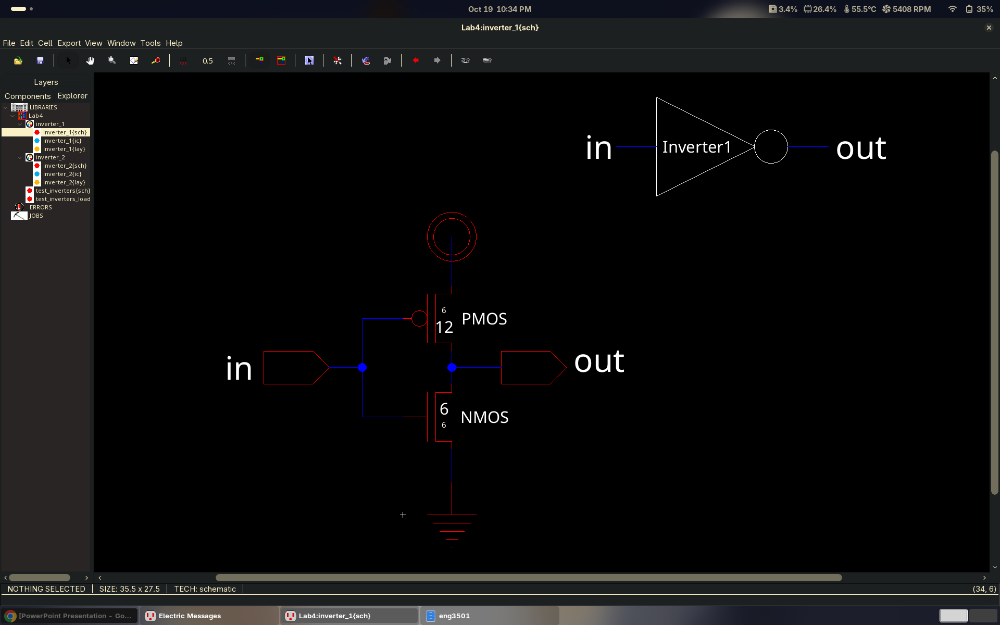
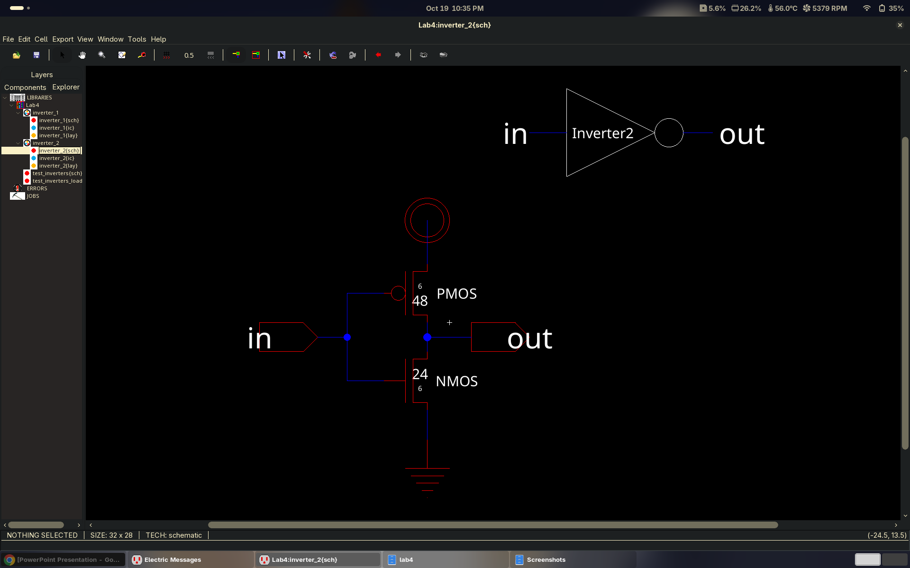
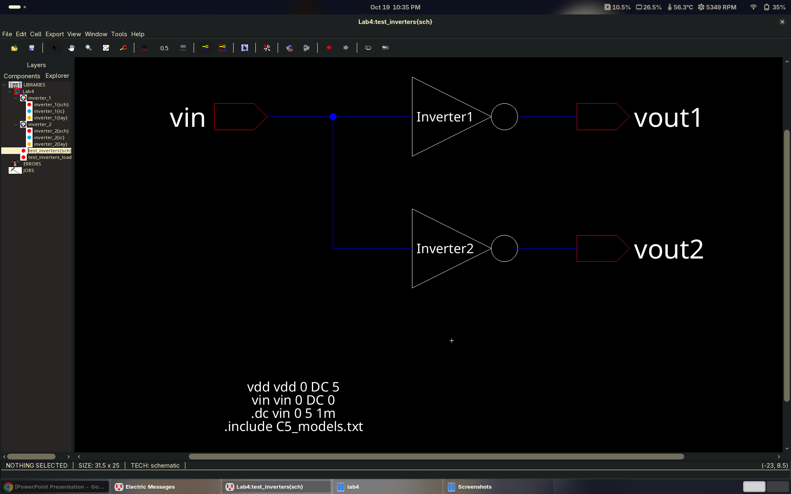
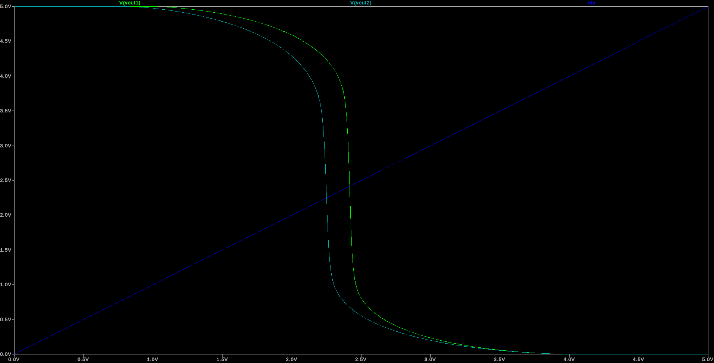
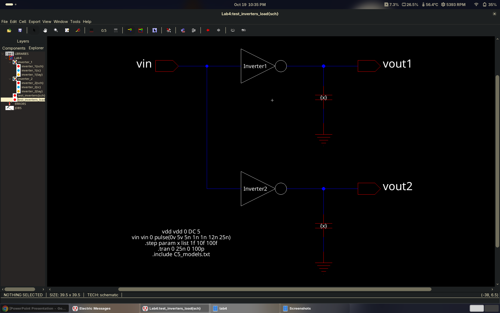
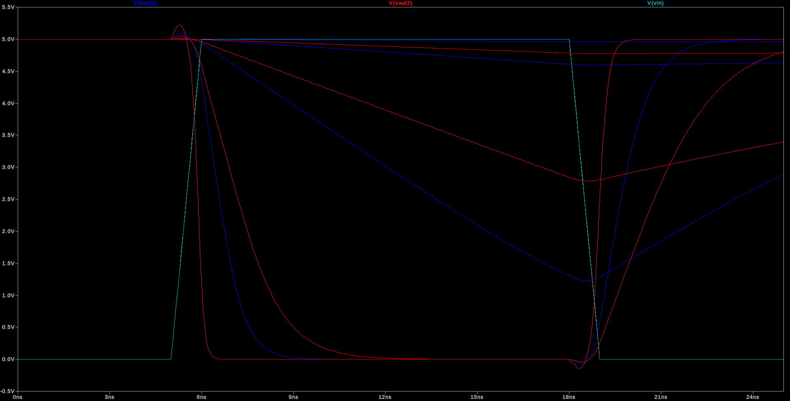
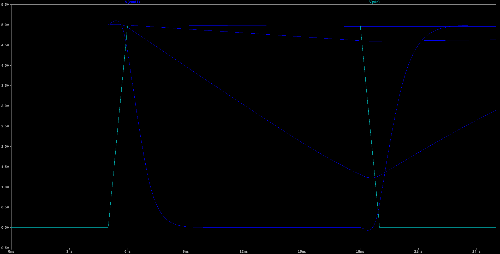
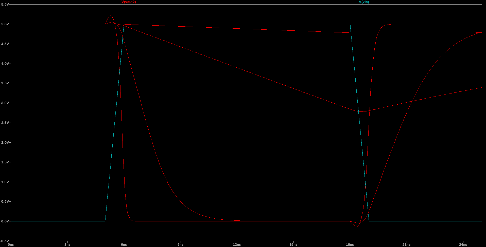
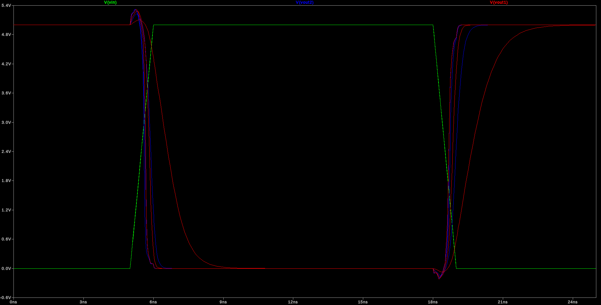

# Lab 4: CMOS Inverter Sizing and Load

**ENCE 3501 VLSI | University of Denver | Fall Quarter 2026 | Charlie Shields**

Two CMOS inverters with the same 2:1 PMOS/NMOS ratio but different absolute size (1x and 4x), compared in LTspice against the C5 models: a DC sweep for the voltage transfer curve, then a transient with a pulse input and a stepped capacitive load. Designed in Electric VLSI (`mocmos`, MOSIS).

**Jump to:** [Inverters](#inverters) | [DC transfer](#dc-transfer) | [Transient with load](#transient-with-load) | [Layout](#layout) | [Notes](#notes) | [Files](#files)

---

## Inverters

Both cells are the same schematic (PMOS on top, NMOS on the bottom, gates tied to `in`, drains tied to `out`) at different sizes. Electric shows W/L in lambda; the SPICE deck uses microns (1 lambda = 0.3 um).

| Cell | NMOS W/L | PMOS W/L | NMOS (um) | PMOS (um) |
|---|---|---|---|---|
| `inverter_1` | 6 / 6 | 12 / 6 | 1.8 / 1.8 | 3.6 / 1.8 |
| `inverter_2` | 24 / 6 | 48 / 6 | 7.2 / 1.8 | 14.4 / 1.8 |

`inverter_2` is 4x the width of `inverter_1` at the same length, so it has 4x the drive strength and 4x the gate capacitance.



*Electric `inverter_1{sch}`. 6/6 NMOS, 12/6 PMOS.*



*Electric `inverter_2{sch}`. 24/6 NMOS, 48/6 PMOS.*

---

## DC transfer

`test_inverters{sch}` drives both inverters from one `vin` and probes `vout1` / `vout2`. The SPICE card on the schematic is:

```
vdd vdd 0 DC 5
vin vin 0 DC 0
.dc vin 0 5 1m
.include C5_models.txt
```



*Electric `test_inverters{sch}`. Shared `vin`, `Inverter1` to `vout1`, `Inverter2` to `vout2`.*



*LTspice DC sweep, `vin` 0 to 5 V. Green is `vout1` (1x), cyan is `vout2` (4x), blue is the `vin` line for reference.*

Both curves swing rail to rail with a sharp transition. Reading off where each crosses the `vin` line, the switching threshold of `inverter_1` is about 2.4 V and `inverter_2` is about 2.25 V. Same P/N ratio, so the thresholds are close; the small offset is the model's width dependence rather than anything in the topology.

---

## Transient with load

`test_inverters_load{sch}` adds a capacitor to ground on each output and switches `vin` with a pulse. The cap value is a parameter, `{x}`, stepped over 1 fF, 10 fF, and 100 fF in one run.

```
vdd vdd 0 DC 5
vin vin 0 pulse(0v 5v 5n 1n 1n 12n 25n)
.step param x list 1f 10f 100f
.tran 0 25n 0 100p
.include C5_models.txt
```



*Electric `test_inverters_load{sch}`. Each inverter output drives its own `{x}` load cap.*

Both inverters, all three loads:



*LTspice `.tran`, 0 to 25 ns. Blue is `vout1`, red is `vout2`, cyan is `vin`.*

Per inverter, to make the 1x and 4x comparison readable:



*`inverter_1` (1x), `vout1` against `vin` for each load.*



*`inverter_2` (4x), `vout2` against `vin` for each load.*



*Second sweep of `vin`, `vout1`, `vout2`; see `sim/test_inverters_load2.plt`.*

Observations:

- The output edge slows as `x` grows, as expected for an RC-limited transition; the 100 fF case on the 1x inverter is the slowest by a wide margin.
- At the same load, the 4x inverter switches faster than the 1x inverter, since it can source and sink 4x the current into the same cap.
- Small overshoot above `vdd` and below `gnd` right at the input edge in the lighter-load cases: gate-drain coupling pushes the output past the rail until the drive takes over.

---

## Layout

<!-- TODO: inverter_1{lay} screenshot + DRC result -->
<!-- TODO: inverter_2{lay} screenshot + DRC result -->
<!-- TODO: layout-vs-schematic / extracted simulation if required by the handout -->

`inverter_1{lay}` and `inverter_2{lay}` exist in `Lab4.jelib` as empty cells and are not drawn yet.

---

## Notes

- Electric writes the `.spi` deck next to the library, so after a re-run the generated files land in `lab4/`; the copies under `sim/` are the ones used for the plots above.
- LTspice prints `Pd = 0 is less than W` / `Ps = 0 is less than W` warnings for every MOSFET. The schematic MOSFETs carry no drain/source perimeter, so these are expected and harmless here; they will go away once the sim is run from extracted layout.
- The schematic-level deck has no parasitics beyond the explicit `{x}` caps.

---

## Files

| Path | Purpose |
|---|---|
| `Lab4.jelib` | Electric library: `inverter_1`, `inverter_2`, `test_inverters`, `test_inverters_load` |
| `C5_models.txt` | C5 SPICE models, `.include`d by the decks |
| `sim/test_inverters.*` | DC sweep deck, log, and raw data |
| `sim/test_inverters_load1.*`, `load2.*` | Transient decks, logs, raw data, and LTspice plot settings (`.plt`) |
| `images/` | Screenshots used above |
