# Lab 5: Logic Gates and Full Adder

**ENCE 3501 VLSI | University of Denver | Fall Quarter 2026 | Charlie Shields**

CMOS NAND, NOT, and XOR standard cells (all 6u/2u), combined into a 1-bit full adder. Electric VLSI (`mocmos`) + LTspice with the C5 models.

---

## Part 1: Gates

| Cell | Transistors |
|---|---|
| `NAND` | 2 NMOS series, 2 PMOS parallel |
| `NOT` | 1 NMOS, 1 PMOS |
| `XOR` | 12 (static CMOS XOR + two input inverters) |

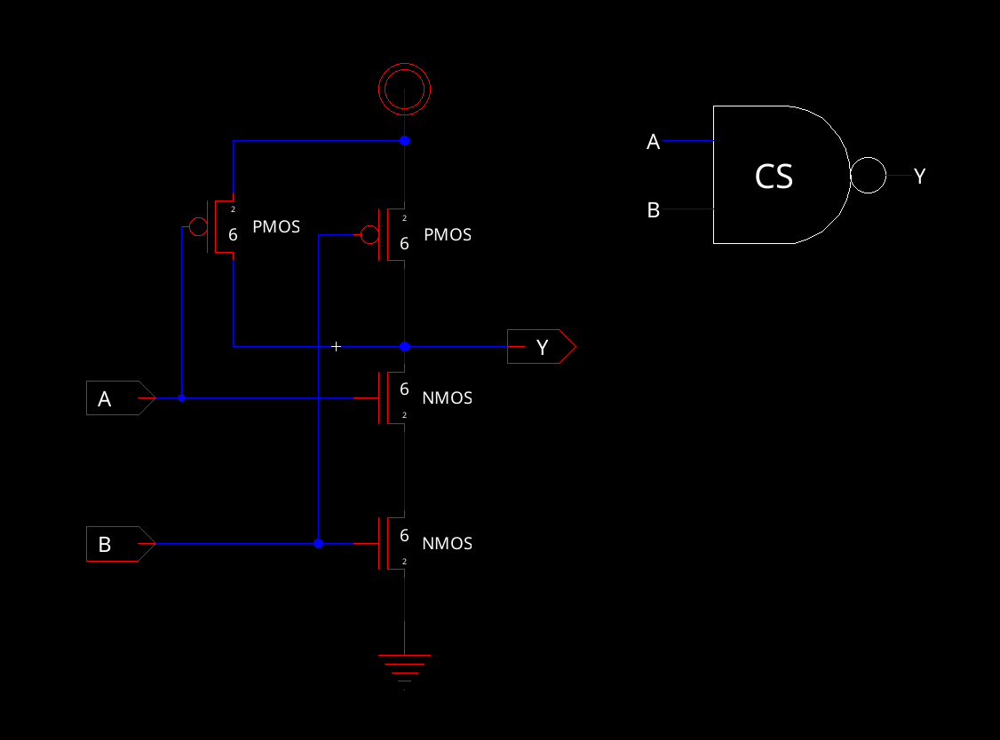

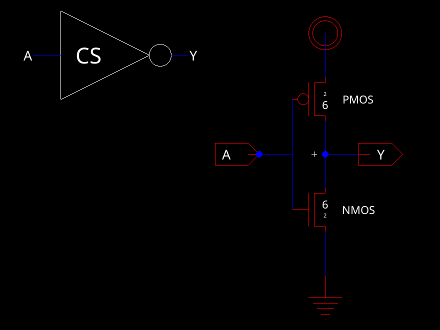

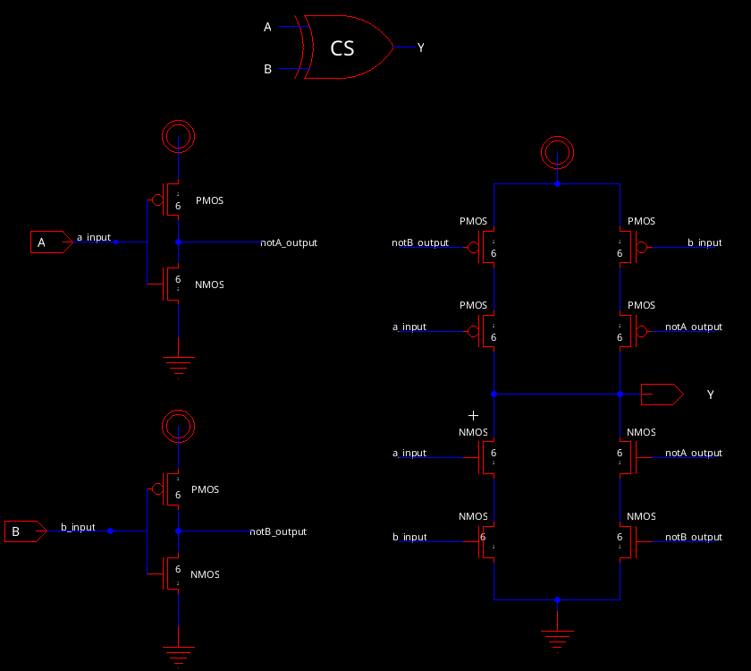

*XOR: pull-up conducts for (A=0, B=1) or (A=1, B=0); pull-down for A=B. Inner gates connect to `notA_output` / `notB_output` by net name.*

### Simulation

```
vdd vdd 0 DC 5
va va 0 pulse(0v 5v 0n 1n 1n 20n 40n)
vb vb 0 pulse(0v 5v 0n 1n 1n 10n 20n)
.tran 0 40n 0 50p
.include C5_models.txt
```

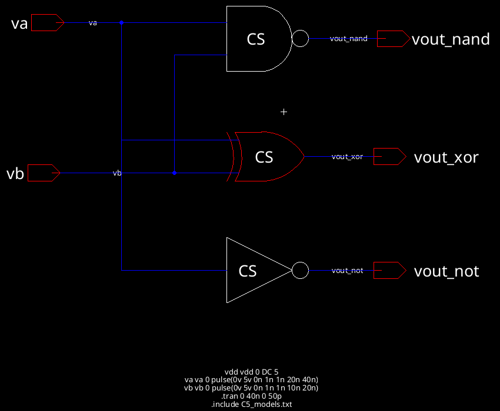

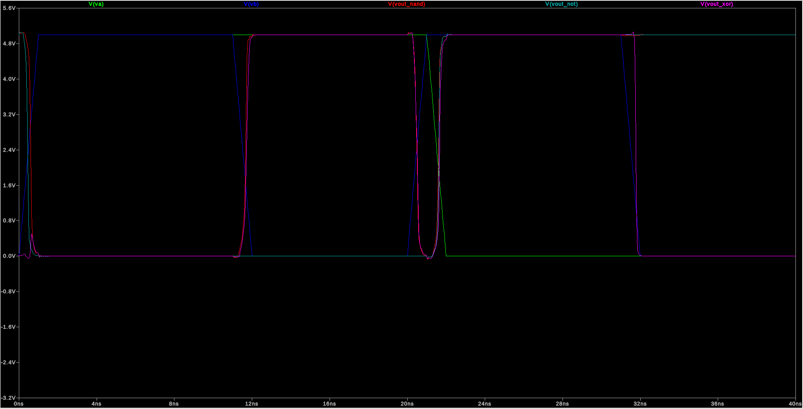

| t | A | B | NAND | XOR | NOT |
|---|---|---|---|---|---|
| 6 ns | 1 | 1 | 0 | 0 | 0 |
| 16 ns | 1 | 0 | 1 | 1 | 0 |
| 26 ns | 0 | 1 | 1 | 1 | 1 |
| 36 ns | 0 | 0 | 1 | 0 | 1 |

All four input cases give the correct output.

---

## Glitches

When a gate's inputs don't change at the same time, it can briefly see an in-between input and output the wrong value.

This shows up in the gate sim at 20 ns: AB goes 10 → 01, but B rises before A falls, so the gates see 11 for about 1 ns. NAND and XOR both drop to ~0 V when they should stay high. NOT only depends on A, so it doesn't glitch.

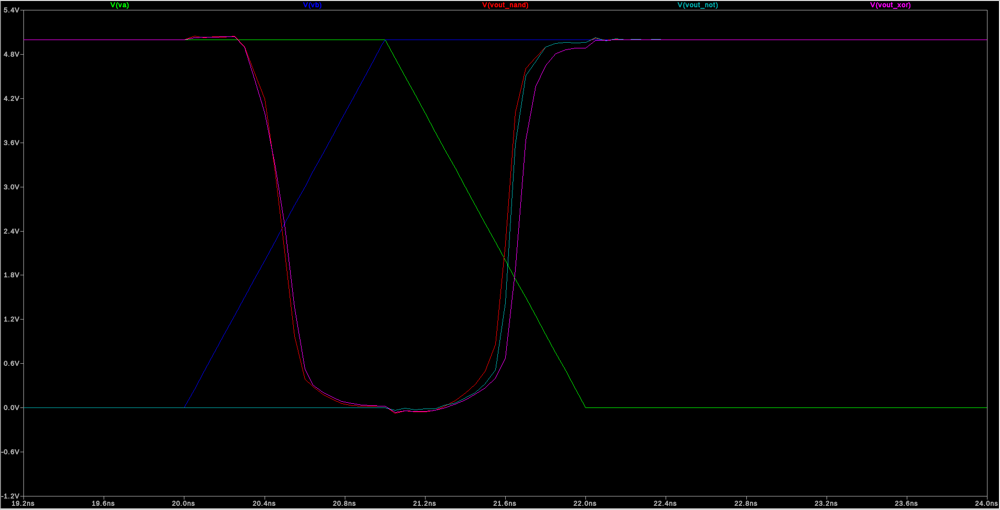

`sim_glitch` tests this on purpose by delaying one XOR input by 2 ns:

```
vdd vdd 0 DC 5
vga ga 0 pulse(0v 5v 10n 1n 1n 20n 40n)
vgb gb 0 pulse(0v 5v 12n 1n 1n 20n 40n)
.tran 0 40n 0 20p
.include C5_models.txt
```

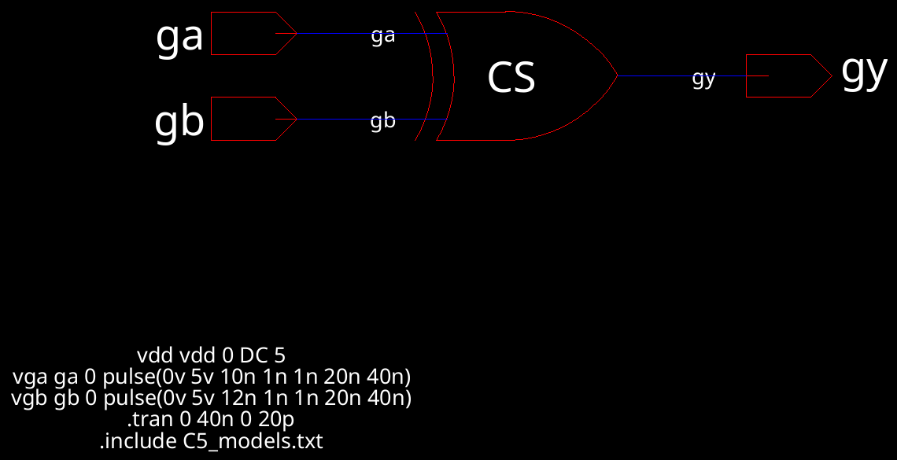

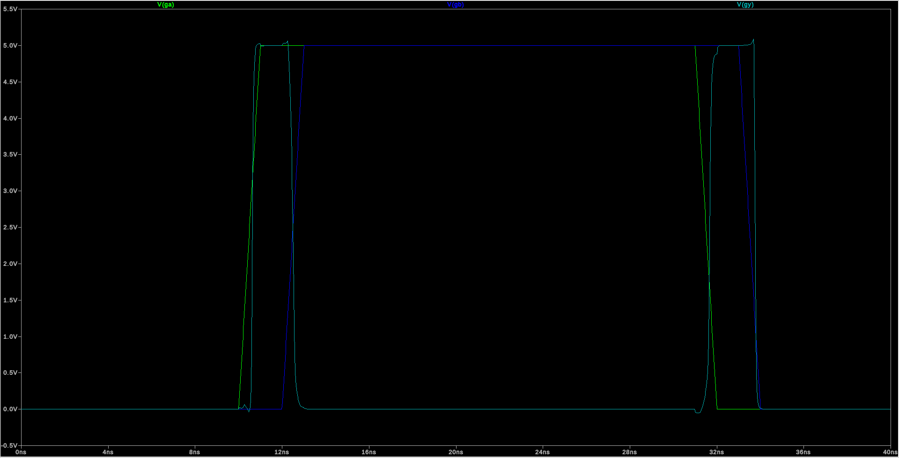

| Inputs | `gy` high | Width |
|---|---|---|
| 00 → 10 → 11 | 10.62 – 12.50 ns | 1.88 ns |
| 11 → 01 → 00 | 31.66 – 33.76 ns | 2.10 ns |

The output should stay at 0, but it pulses to a full 5 V for about as long as the skew. If the skew were shorter than the gate delay, the output wouldn't have time to switch and there'd be no glitch.

---

## Part 2: Full adder

- `S = A XOR B XOR Cin` (2 XOR)
- `Cout = NAND(NAND(A, B), NAND(A XOR B, Cin))` (3 NAND)

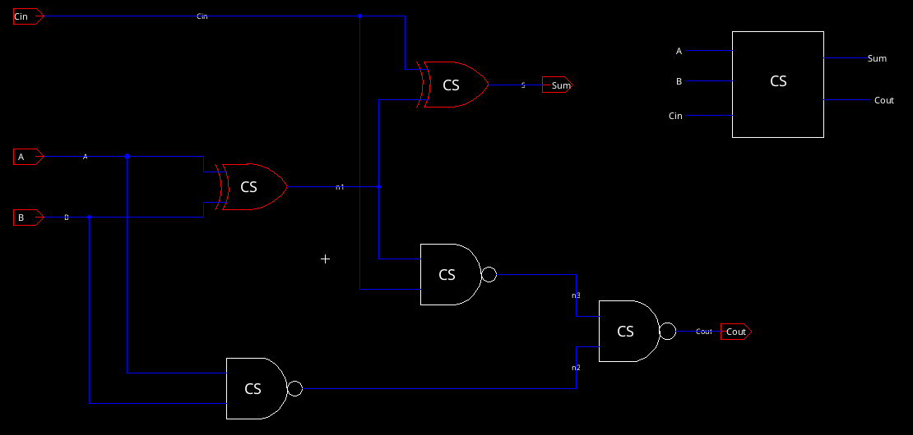

### Simulation

```
vdd vdd 0 DC 5
va a 0 pulse(0v 5v 0n 1n 1n 80n 160n)
vb b 0 pulse(0v 5v 0n 1n 1n 40n 80n)
vcin cin 0 pulse(0v 5v 0n 1n 1n 20n 40n)
.tran 0 160n 0 100p
.include C5_models.txt
```

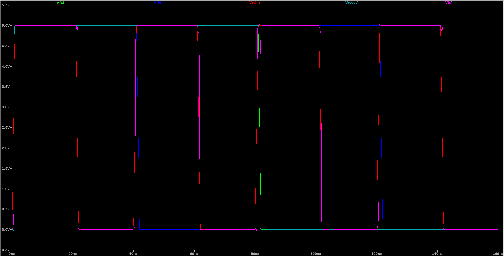

| A | B | Cin | S | Cout |
|---|---|---|---|---|
| 1 | 1 | 1 | 1 | 1 |
| 1 | 1 | 0 | 0 | 1 |
| 1 | 0 | 1 | 1 | 1 |
| 1 | 0 | 0 | 0 | 1 |
| 0 | 1 | 1 | 1 | 0 |
| 0 | 1 | 0 | 0 | 0 |
| 0 | 0 | 1 | 1 | 0 |
| 0 | 0 | 0 | 0 | 0 |

Matches the truth table for all 8 inputs.

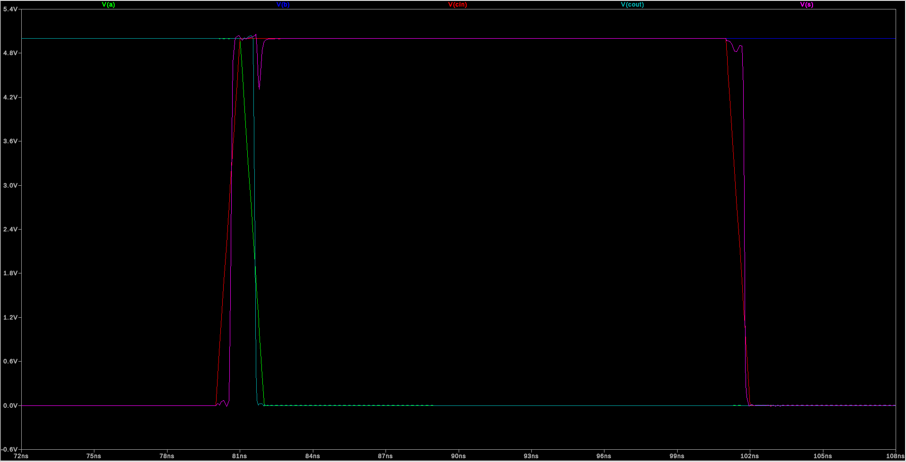

At 80 ns the inputs go 100 → 011, but A falls after B and Cin rise, so the adder sees 111 for ~1 ns. Cout stays high ~1.6 ns longer than it should, and S has a small dip (to 4.4 V) when the second XOR's inputs swap. The dip doesn't cross the threshold, so it isn't a real glitch.

---

## Files

| Path | Purpose |
|---|---|
| `Lab5.jelib` | Electric library |
| `C5_models.txt` | C5 SPICE models |
| `sim/` | LTspice decks, waveform data, plot settings |
| `images/` | Screenshots |
| `ENCE_3501_Lab_5.pdf` | Handout |
| `Lab_5_Full_Adder.pdf` | Slides |
